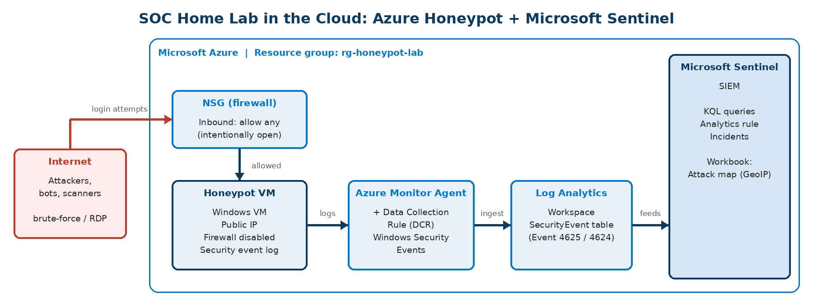

# SOC - Azure Sentinel Honeypot Home Lab

## Description
Cloud SOC home lab on Microsoft Azure: an intentionally exposed Windows VM acts as a honeypot and forwards its security logs to Microsoft Sentinel (SIEM). Malicious login attempts are detected with KQL, each attacking IP is geolocated to show where attacks come from, and a scheduled analytics rule turns brute-force activity into Sentinel incidents.


## Overview
This project builds a small Security Operations Center (SOC) environment in the cloud using an Azure free account. A virtual machine is deliberately exposed to the public internet so that real-world attackers find it. Its security logs are forwarded to **Microsoft Sentinel**, where I analyze them with **KQL**, detect malicious activity, and identify the countries and cities the attacks come from using IP geolocation.
 
**Goal:** practice the core SOC analyst workflow end to end: collect logs, query them, detect suspicious behavior, trace its origin, alert on it, and report findings.
 
**Scope:** detection, alerting, and attacker-origin analysis with KQL tables. Map visualization is out of scope for now.


## Architecture


## Tools and Technologies

| Area            | Tool                                              |
|-----------------|---------------------------------------------------|
| Cloud platform  | Microsoft Azure (free account)                    |
| Honeypot        | Windows virtual machine with a public IP          |
| Network control | Azure Network Security Group (NSG)                |
| Log collection  | Azure Monitor Agent + Data Collection Rule        |
| SIEM            | Microsoft Sentinel on a Log Analytics workspace   |
| Query language  | Kusto Query Language (KQL)                        |
| Enrichment      | `geo_info_from_ip_address()` (KQL built-in GeoIP) |
| Framework       | MITRE ATT&CK                                      |


## Lab Setup
 
### 1. Prepare the Azure account
 
- Create an Azure free account.
- **Set a budget alert** before creating anything (Cost Management > Budgets).
- Create a dedicated resource group, for example `rg-honeypot-lab`. Everything in this lab goes into it, so cleanup is one delete.
### 2. Create the honeypot VM
 
- Create a Windows VM in the resource group with a public IP address.
- Use a **unique, strong admin password** that you use nowhere else.
- Do not connect the VM to any other network or resource.
### 3. Expose the VM on purpose
 
- In the VM's NSG, add an inbound rule allowing **any source / any port to any destination / any port** with a high priority.
- Inside the VM, **disable Windows Defender Firewall** (domain, private, and public profiles) so attackers can reach the services.
- Confirm the VM answers from the internet, for example by pinging its public IP from my own machine.
### 4. Set up Microsoft Sentinel
 
- Create a Log Analytics workspace in the same resource group.
- Add Microsoft Sentinel to the workspace.
- Open Content hub and install the **Windows Security Events** solution.
- In Data connectors, enable **Windows Security Events via AMA** and create a Data Collection Rule that targets the honeypot VM and collects **All Security Events**.
### 5. Verify logs are arriving
 
In Sentinel > Logs, run:
 
```kql
SecurityEvent
| take 20
```
 
Rows appearing means the pipeline works. It can take several minutes after the first attacks.


## Detection and Analysis (KQL)
 
All queries are saved in [`/queries`](queries). Windows Event ID **4625** is a failed logon, and **4624** is a successful one.
 
**1. Failed logons by source IP** — [`01-failed-logons-by-ip.kql`](queries/01-failed-logons-by-ip.kql)
 
```kql
SecurityEvent
| where EventID == 4625
| summarize FailedAttempts = count() by IpAddress
| order by FailedAttempts desc
```
 
**2. Most targeted usernames** — [`02-most-targeted-usernames.kql`](queries/02-most-targeted-usernames.kql)
 
```kql
SecurityEvent
| where EventID == 4625
| summarize Attempts = count() by TargetUserName
| order by Attempts desc
| take 20
```
 
**3. Where attacks come from: failed logons by country** — [`03-attacks-by-country.kql`](queries/03-attacks-by-country.kql)
 
```kql
SecurityEvent
| where EventID == 4625 and isnotempty(IpAddress)
| extend geo = geo_info_from_ip_address(IpAddress)
| extend Country = tostring(geo.country), City = tostring(geo.city)
| summarize FailedAttempts = count(), UniqueIPs = dcount(IpAddress) by Country
| order by FailedAttempts desc
```
 

 
**4. Brute-force pattern: 10+ failures from one IP within 5 minutes** — [`04-brute-force-detection.kql`](queries/04-brute-force-detection.kql)
 
```kql
SecurityEvent
| where EventID == 4625
| summarize Failures = count() by IpAddress, bin(TimeGenerated, 5m)
| where Failures >= 10
| order by Failures desc
```
 
**5. Sanity check: any successful logons that weren't me?** — [`05-successful-remote-logons.kql`](queries/05-successful-remote-logons.kql)
 
```kql
SecurityEvent
| where EventID == 4624 and LogonType in (3, 10)
| summarize Logons = count() by IpAddress, TargetUserName
```

## Detection Engineering: Scheduled Analytics Rule
 
Query 4 is turned into a **scheduled analytics rule** in Sentinel (Analytics > Create > Scheduled query rule), so brute-force activity raises an incident automatically instead of waiting for someone to run a query.
 
| Setting          | Value                                                        |
|------------------|--------------------------------------------------------------|
| Name             | Honeypot – RDP/SMB brute force (10+ failures in 5 min)       |
| Severity         | Medium                                                       |
| MITRE ATT&CK     | Credential Access – T1110 Brute Force                        |
| Rule query       | [`06-analytics-rule-brute-force.kql`](queries/06-analytics-rule-brute-force.kql) |
| Run frequency    | Every 5 minutes                                              |
| Lookup period    | Last 5 minutes                                               |
| Alert threshold  | Number of results > 0                                        |
| Entity mapping   | IP → `IpAddress`, Account → `TargetUserName`                 |
| Incident creation| Enabled, alerts grouped by source IP                         |
 
```kql
SecurityEvent
| where EventID == 4625 and isnotempty(IpAddress)
| summarize Failures = count(), TargetedAccounts = make_set(TargetUserName, 10)
    by IpAddress, bin(TimeGenerated, 5m)
| where Failures >= 10
| extend TargetUserName = tostring(TargetedAccounts[0])
```

## MITRE ATT&CK Mapping
 
| Observed behavior                                    | Tactic            | Technique                                  | Evidence (query) |
|------------------------------------------------------|-------------------|--------------------------------------------|------------------|
| Many passwords tried against one account from one IP | Credential Access | T1110.001 – Brute Force: Password Guessing | 1, 4             |
| Common passwords tried across many default accounts  | Credential Access | T1110.003 – Brute Force: Password Spraying | 2                |
| Attempted logon to built-in/default accounts         | Initial Access    | T1078.001 – Valid Accounts: Default Accounts (attempted, not achieved) | 2, 5 |
| Internet-exposed remote services targeted            | Initial Access    | T1133 – External Remote Services           | 1, 5             |


## Results
 
Observation window: **24 hours**
 
| Metric                            | Result                                  |
|-----------------------------------|-----------------------------------------|
| First failed logon after exposure | 20 minutes                              |
| Total failed logon events         | 16,000                                  |
| Unique source IPs                 | 120                                     |
| Countries observed                | 22                                      |
| Most targeted usernames           | administrator, admin, user, test, guest |
| Successful logons by unknown IPs  | 0                                       |
 
**Observations:** Attacks started within minutes of exposure and came in bursts rather than evenly. A small number of IPs produced most of the volume, and the username lists were dominated by default accounts such as administrator and admin. No attacker achieved a successful logon.


## Cleanup
 
- Delete the resource group `rg-honeypot-lab` to remove the VM, NSG, workspace, and Sentinel in one step.
- Confirm in Cost Management that no resources are still billing.

## Skills Demonstrated
 
- SIEM deployment and log onboarding (Microsoft Sentinel, Azure Monitor Agent, Data Collection Rules)
- KQL log analysis and threat detection
- Detection engineering: scheduled analytics rule with entity mapping and incident creation
- Threat intelligence basics: IP geolocation and MITRE ATT&CK mapping
- Cloud security and network exposure control (NSG)
- Cost control and safe lab teardown
- Documentation and reporting
---
 
*Author: Mazen Yousef | [LinkedIn](https://linkedin.com/in/mazenyousef) | [TryHackMe](https://tryhackme.com/p/mazen.yousef)*
